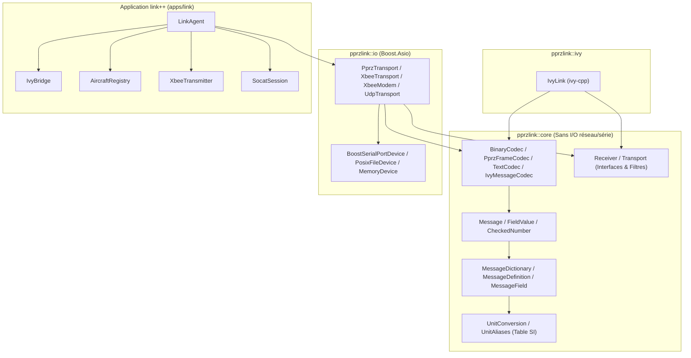

# État de la revue pprzlink++ et link++ après corrections

<!-- etat-valide-2026-10-17 -->
Mise à jour du 17 octobre 2026, après la revue indépendante du commit `9979bc1`.
Les corrections suivantes ont été compilées avec GCC 15.2 sur Ubuntu 26.04,
puis validées par les **31 tests CTest**, y compris les nouvelles régressions.

| Sujet | État validé |
| --- | --- |
| Valeurs flottantes non finies | Les codecs Ivy moderne et Legacy acceptent les formes explicites `nan`/`NAN` et `inf`/`INF`, avec signe. `CAMERA_SNAPSHOT_DL` avec températures indisponibles est transmis sur le lien série. Les débordements numériques et conversions vers entier restent rejetés. |
| Diffusion UDP | Avec `-udp_broadcast`, une commande diffusée produit un seul datagramme dès qu'au moins un avion est actif. Le défaut historique d'OCaml n'est pas reproduit. |
| Saturation XBee | Les 255 identifiants en attente sont protégés. Un nouvel envoi est refusé avec diagnostic, sans arrêter l'agent ni créer un RTT fictif ; la libération ou l'expiration d'un identifiant permet les envois suivants. Les commandes refusées ne sont pas mises en file. |
| Cycle de vie Ivy | `stop()` suspend les abonnements `Receiver::bind`, `start()` les réactive. `close()` termine définitivement la session et fait sortir `run()`. Les exemples livrés utilisent ce contrat. |
| Adressage radio et corrélation | `sendMessageToWithId()` combine une adresse `XbeeAddress`, un identifiant de trame et le choix des réessais radio, sans modifier le destinataire PPRZLINK. |
| Dépendances des valeurs | `BytesBuffer.h` permet aux valeurs et codecs d'utiliser les octets sans inclure l'API des périphériques ou Asio. La cible CMake `core` contient encore les transports et dépend de Boost. |

Les corrections précédentes du RTT, des faux diagnostics Ivy, du déploiement
statique des composants pprzlink dans `link++` et des exceptions documentées
restent en place.

Les sources de référence courantes sont le
[manuel d'API](sw/ext/pprzlink/doc/cpp/reference.md), le
[guide](sw/ext/pprzlink/doc/cpp/guide_d_utilisation.md) et le
[rapport de validation](sw/ext/pprzlink/doc/cpp/validation/LINK_CPP_VALIDATION.md).
Ce dernier distingue les essais C++ actuels des comparaisons OCaml historiques.
Le binaire OCaml local ancien est incompatible avec le runtime OCaml 5.4 installé ;
la comparaison complète avec une référence OCaml reconstruite n'a pas été renouvelée.
Les tests radio emploient des périphériques simulés et des pseudo-terminaux.

Les notes chiffrées et l'ancien ordre de priorité du rapport ci-dessous ne
constituent plus un état du code courant. Les scénarios de changement d'IP,
d'alias série hors `/dev` et de délimiteurs dans les chaînes n'ont pas été retenus
pour ce chantier. Les optimisations de copies et de regex demandent des mesures
avant de justifier une refonte.

<details>
<summary>Rapport initial conservé comme historique, avant les corrections</summary>

# Revue de Qualité de Code — `pprzlink++`, `link++` et Exemples `pprzlink-guide`

## 1. Synthèse Exécutive

La bibliothèque C++ **`pprzlink++`** ([`sw/ext/pprzlink/lib/v2.0/C++/pprzlink`](file:///home/alex/DEV/PAPARAZZI/paparazzi/sw/ext/pprzlink/lib/v2.0/C++/pprzlink)), l'agent sol **`link++`** ([`sw/ext/pprzlink/lib/v2.0/C++/apps/link`](file:///home/alex/DEV/PAPARAZZI/paparazzi/sw/ext/pprzlink/lib/v2.0/C++/apps/link)) et les exemples pédagogiques ([`~/DEV/pprzlink-guide/projet`](file:///home/alex/DEV/pprzlink-guide/projet)) présentent un **très bon niveau de qualité logicielle globale**. Le code a manifestement fait l'objet d'une modernisation C++23 rigoureuse, avec une attention particulière portée aux contrats d'API, à la sûreté des conversions numériques, à la gestion des durées de vie asynchrones (Boost.Asio / Ivy) et aux tests (tests unitaires, tests négatifs de compilation, tests différentiels face à l'agent OCaml historique).

| Axe d'évaluation | Note | Appréciation synthétique |
| :--- | :---: | :--- |
| **Architecture & Modularité CMake** | **9 / 10** | Découpage clair (`core`, `io`, `ivy`), compilation unique via cibles `OBJECT`, séparation nette entre codecs sans I/O et transports. |
| **Modernité C++23 & Typage** | **9 / 10** | Utilisation pertinente des `concept`s, `std::span`, `std::string_view`, `std::expected`, `std::bit_cast`, `std::from_chars`/`std::to_chars`, `[[nodiscard]]`. |
| **Robustesse & Sécurité** | **8.5 / 10** | Validation stricte des bornes numériques, protection contre les formats `printf` dangereux en XML, gestion de `socat` par `pidfd` + `flock`. Quelques cas limites subsistent (conversion hexadécimale d'entiers signés négatifs, échappement de chaînes Ivy). |
| **Concurrence & Asynchronisme** | **8 / 10** | Bonne gestion des annulations Asio via `std::enable_shared_from_this` et époques (`generation`). Quelques subtilités sur l'ordre de verrouillage dans `UdpTransport` et les fuites d'abonnements en cas de `sendRequest` sans réponse. |
| **Performances & Allocations** | **6.5 / 10** | Point Perfectible Principal : `Message` copie intégralement `MessageDefinition` (et son `std::map`) à chaque instanciation, et `parseMessageBody` recompile une `std::regex` à chaque message Ivy reçu. |
| **Documentation & Tests** | **9.5 / 10** | Doxygen complet (`FAIL_ON_WARNINGS`), commentaires explicites sur les invariants, couverture de tests remarquable. |

---

## 2. Vue d'Ensemble Architecturale



### Points forts majeurs de la conception
1. **Validation numérique sans perte implicite ([`CheckedNumber.h`](file:///home/alex/DEV/PAPARAZZI/paparazzi/sw/ext/pprzlink/lib/v2.0/C++/pprzlink/detail/CheckedNumber.h#L52-L88))** :
   - Les écritures et conversions explicites (`getValueAs<T>()`) rejettent les valeurs hors bornes, les flottants fractionnaires vers un entier (`std::trunc(value) != value`), et les `NaN`/`Inf` vers un entier.
   - Le calcul de la borne supérieure entière depuis un flottant utilise `std::ldexp(1.0L, std::numeric_limits<To>::digits)` ([`CheckedNumber.h:79`](file:///home/alex/DEV/PAPARAZZI/paparazzi/sw/ext/pprzlink/lib/v2.0/C++/pprzlink/detail/CheckedNumber.h#L79)), évitant le piège classique de l'arrondi de `UINT64_MAX` en `double` (`2^64`).
2. **Séparation entre lecture exacte, vue sans copie et conversion explicite ([`FieldValue.h`](file:///home/alex/DEV/PAPARAZZI/paparazzi/sw/ext/pprzlink/lib/v2.0/C++/pprzlink/FieldValue.h#L186-L284))** :
   - `getField<T>()` exige le type exact du schéma XML (ou emprunte un `std::string_view` / `std::span<const T>` sans allocation).
   - `getFieldAs<T>()` exprime clairement l'intention d'une conversion numérique vérifiée.
   - `getFieldSI()` / `setFieldSI()` isole la conversion affine vers le Système International cohérent via une table statique vérifiée au chargement du XML ([`UnitAliases.cpp`](file:///home/alex/DEV/PAPARAZZI/paparazzi/sw/ext/pprzlink/lib/v2.0/C++/pprzlink/UnitAliases.cpp), [`UnitConversion.cpp`](file:///home/alex/DEV/PAPARAZZI/paparazzi/sw/ext/pprzlink/lib/v2.0/C++/pprzlink/UnitConversion.cpp)).
3. **Gestion exemplaire du cycle de vie asynchrone Asio** :
   - [`BoostSerialPortDevice`](file:///home/alex/DEV/PAPARAZZI/paparazzi/sw/ext/pprzlink/lib/v2.0/C++/pprzlink/BoostSerialPortDevice.cpp#L45-L106), [`PosixFileDevice`](file:///home/alex/DEV/PAPARAZZI/paparazzi/sw/ext/pprzlink/lib/v2.0/C++/pprzlink/PosixFileDevice.cpp#L25-L72), [`MemoryDevice`](file:///home/alex/DEV/PAPARAZZI/paparazzi/sw/ext/pprzlink/lib/v2.0/C++/pprzlink/MemoryDevice.cpp#L15-L45) et [`Receiver`](file:///home/alex/DEV/PAPARAZZI/paparazzi/sw/ext/pprzlink/lib/v2.0/C++/pprzlink/Receiver.cpp#L16-L67) isolent leur état interne dans une structure partagée (`std::shared_ptr<State>` / `std::weak_ptr<State>`) et utilisent un compteur d'époque (`inputGeneration` / `generation`).
   - Ainsi, la destruction d'un périphérique ou un `stop()` suivi d'un `start()` immédiat avant que le handler d'annulation Asio (`operation_aborted`) n'ait été exécuté ne provoque ni *use-after-free*, ni corruption du tampon de lecture, ni réinsertion d'octets issus d'un ancien débit en bauds.

---

## 3. Analyse Détaillée de la Bibliothèque `pprzlink++`

### 3.1. Performance & Empreinte Mémoire : Coût caché de `Message` et `MessageDefinition`

> [!IMPORTANT]
> C'est le point d'amélioration technique le plus significatif de la bibliothèque `pprzlink++`.

Dans [`Message.h`](file:///home/alex/DEV/PAPARAZZI/paparazzi/sw/ext/pprzlink/lib/v2.0/C++/pprzlink/Message.h#L419-L420) et [`MessageDefinition.h`](file:///home/alex/DEV/PAPARAZZI/paparazzi/sw/ext/pprzlink/lib/v2.0/C++/pprzlink/MessageDefinition.h#L108-L113) :
```cpp
// MessageDefinition.h
class MessageDefinition {
  ...
  std::vector<MessageField> fields;
  std::map<std::string, size_t> fieldNameToIndex;
};

// Message.h
class Message {
  ...
  MessageDefinition def;
  std::map<std::string, FieldValue> fieldValues;
};
```

**Problèmes induits à chaque création/décodage d'un `Message`** (par exemple dans [`decodeMessagePayload`](file:///home/alex/DEV/PAPARAZZI/paparazzi/sw/ext/pprzlink/lib/v2.0/C++/pprzlink/detail/MessagePayload.h#L67-L81)) :
1. **Copie profonde du schéma** : `Message message(definition);` copie par valeur `MessageDefinition`, ce qui duplique le `std::vector<MessageField>` (chaque [`MessageField`](file:///home/alex/DEV/PAPARAZZI/paparazzi/sw/ext/pprzlink/lib/v2.0/C++/pprzlink/MessageField.h#L129-L137) contenant 5 `std::string`) **et** reconstruit l'arbre rouge-noir `std::map<std::string, size_t> fieldNameToIndex` sur le tas.
2. **Duplication de `MessageField` dans chaque `FieldValue`** : chaque [`FieldValue`](file:///home/alex/DEV/PAPARAZZI/paparazzi/sw/ext/pprzlink/lib/v2.0/C++/pprzlink/FieldValue.h#L311-L312) stocké dans `fieldValues` recopie à son tour son `MessageField` par valeur.
3. **Indirection `index -> nom -> std::map` lors du décodage/encodage binaire** :
   Dans [`Message::addFieldToBuffer`](file:///home/alex/DEV/PAPARAZZI/paparazzi/sw/ext/pprzlink/lib/v2.0/C++/pprzlink/Message.cpp#L164-L167), l'accès par indice `index` résout `def.getField(index).getName()`, puis effectue deux recherches dans `std::map` (`def.getField(name)` dans `fieldWithValue`, puis `fieldValues.find(name)`).

**Recommandation** :
- Encapsuler le contenu immuable de `MessageDefinition` dans un `std::shared_ptr<const Impl>` : copier un `MessageDefinition` dans `Message` (et `MessageField` dans `FieldValue`) devient une opération $O(1)$ sans allocation dynamique tout en conservant la garantie que `Message` possède son schéma indépendamment de la durée de vie du `MessageDictionary`.
- Dans `Message`, remplacer `std::map<std::string, FieldValue>` par un `std::vector<std::optional<FieldValue>>` dimensionné à `def.getNbFields()` :
  - L'accès par indice (`getField(size_t)`, `addFieldFromBuffer`, `addFieldToBuffer`) devient un accès direct $O(1)$ sans recherche par chaîne.
  - L'accès par nom (`getField(const std::string&)`) utilise l'index déjà résolu par `def` (`fieldNameToIndex`).

---

### 3.2. Performance Critique : Recompilation de `std::regex` dans `IvyMessageCodec`

Dans [`IvyMessageCodec.cpp`](file:///home/alex/DEV/PAPARAZZI/paparazzi/sw/ext/pprzlink/lib/v2.0/C++/pprzlink/IvyMessageCodec.cpp#L244-L257) :
```cpp
Message parseMessageBody(const MessageDefinition &definition, std::string_view sender,
                         std::string_view body)
{
  const std::regex regexp("^" + messageRegexp(definition));
  std::match_results<std::string_view::const_iterator> matches;
  if (!std::regex_match(body.begin(), body.end(), matches, regexp)) {
    throw wrong_message_format("Wrong fields in message " + definition.getName());
  }
  ...
```
Cette fonction est appelée **à chaque message reçu** lorsque l'on utilise :
- L'API réactive `Receiver` sur [`IvyLink::start()`](file:///home/alex/DEV/PAPARAZZI/paparazzi/sw/ext/pprzlink/lib/v2.0/C++/pprzlink/IvyLink.cpp#L95-L100) ;
- L'abonnement par émetteur [`IvyLink::subscribeSender()`](file:///home/alex/DEV/PAPARAZZI/paparazzi/sw/ext/pprzlink/lib/v2.0/C++/pprzlink/IvyLink.cpp#L154-L167).

Construire la chaîne `messageRegexp(definition)` et compiler un automate `std::regex` à chaque message reçu est très coûteux (plusieurs dizaines de microsecondes et de multiples allocations par message).
De même, dans [`LegacyIvyCodec.cpp:36`](file:///home/alex/DEV/PAPARAZZI/paparazzi/sw/ext/pprzlink/lib/v2.0/C++/pprzlink/LegacyIvyCodec.cpp#L36), `std::regex_match(format, match, pattern)` est exécuté pour chaque champ numérique lors de `serializeLegacyMessage` (et alloue un `std::smatch` même lorsque `xmlFormat` est vide et remplacé par `"%f"` / `"%d"` / `"%u"`).

**Recommandation** :
- Dans `LegacyIvyCodec.cpp`, court-circuiter la validation par regex lorsque `xmlFormat.empty()` (les formats par défaut `"%f"`, `"%c"`, `"%d"`, `"%u"` sont connus à la compilation).
- Dans `parseMessageBody`, soit analyser directement les jetons comme le fait [`parseLegacyMessageBody`](file:///home/alex/DEV/PAPARAZZI/paparazzi/sw/ext/pprzlink/lib/v2.0/C++/pprzlink/LegacyIvyCodec.cpp#L126-L151), soit précalculer/mettre en cache la `std::regex` au sein de `MessageDefinition`.

---

### 3.3. Bogues Subtils et Cas Limites dans les Codecs

#### A. Extension de signe lors du formatage hexadécimal/octal/non-signé dans `LegacyIvyCodec.cpp`
Dans [`LegacyIvyCodec.cpp`](file:///home/alex/DEV/PAPARAZZI/paparazzi/sw/ext/pprzlink/lib/v2.0/C++/pprzlink/LegacyIvyCodec.cpp#L61-L67) :
```cpp
if (std::string_view("diuoxX").find(conversion) == std::string_view::npos)
  throw wrong_message_format("Expected an integer XML format");
checked += "ll";
checked += conversion;
if (conversion == 'd' || conversion == 'i') return print(static_cast<long long>(value));
return print(static_cast<unsigned long long>(value));
```
> [!WARNING]
> Si un champ XML est de type signé (`int8`, `int16`, `int32`) avec une valeur négative (ex. `int8_t{-1}`) et un attribut `format="0x%02x"`, `static_cast<unsigned long long>(value)` effectue une extension de signe sur 64 bits (`0xffffffffffffffffULL`) et `snprintf` avec `"%02llx"` produit **`0xffffffffffffffff`** (16 chiffres `f`) au lieu de **`0xff`** (ou `0xffffffff`) !

**Correction suggérée** :
Pour les conversions non signées (`u`, `o`, `x`, `X`), convertir d'abord vers le type non signé de même largeur (`std::make_unsigned_t<Number>`) avant d'élargir vers `unsigned long long` :
```cpp
using Unsigned = std::make_unsigned_t<Number>;
return print(static_cast<unsigned long long>(static_cast<Unsigned>(value)));
```

#### B. Quoting et caractères spéciaux dans `TextCodec.cpp` et `IvyMessageCodec.cpp`
Dans [`TextCodec.cpp`](file:///home/alex/DEV/PAPARAZZI/paparazzi/sw/ext/pprzlink/lib/v2.0/C++/pprzlink/TextCodec.cpp#L76-L82) :
```cpp
} else if constexpr (std::same_as<T, std::string>) {
  const bool quoted = format == TextFormat::Ivy &&
                      (value.empty() || value.find(' ') != std::string::npos);
  if (quoted) stream.put('"');
  stream.write(value.data(), value.size());
  if (quoted) stream.put('"');
}
```
Trois cas limites peuvent mettre en défaut l'aller-retour (*round-trip*) Ivy :
1. **Chaîne contenant des guillemets `"`** : si un `string` ou un `char[]` contient `"`, `writeIvyField` l'écrit tel quel et [`messageRegexp`](file:///home/alex/DEV/PAPARAZZI/paparazzi/sw/ext/pprzlink/lib/v2.0/C++/pprzlink/IvyMessageCodec.cpp#L159) (`(?:"[^"]*"|[^ ]+)`) échoue au décodage.
2. **Chaîne contenant une tabulation `\t` sans espace `' '`** : `value.find(' ')` vaut `npos`, la chaîne n'est pas entourée de guillemets, et [`parseLegacyMessageBody`](file:///home/alex/DEV/PAPARAZZI/paparazzi/sw/ext/pprzlink/lib/v2.0/C++/pprzlink/LegacyIvyCodec.cpp#L131) la découpe en plusieurs champs sur `" \t"`.
3. **Chaîne sans espace commençant et finissant par `"` (ex. `"\"abc\""`)** : elle est émise sans guillemets additionnels, puis [`unquote()`](file:///home/alex/DEV/PAPARAZZI/paparazzi/sw/ext/pprzlink/lib/v2.0/C++/pprzlink/IvyMessageCodec.cpp#L49-L56) retire ses guillemets à la réception (`"abc"`).

---

### 3.4. Concurrence, Verrouillage et Gestion des Abonnements

#### A. Ordre de prise de verrous dans `UdpTransport`
Dans [`UdpTransport.cpp`](file:///home/alex/DEV/PAPARAZZI/paparazzi/sw/ext/pprzlink/lib/v2.0/C++/pprzlink/UdpTransport.cpp) :
- `start()` ([L62](file:///home/alex/DEV/PAPARAZZI/paparazzi/sw/ext/pprzlink/lib/v2.0/C++/pprzlink/UdpTransport.cpp#L62)), `stop()` ([L70](file:///home/alex/DEV/PAPARAZZI/paparazzi/sw/ext/pprzlink/lib/v2.0/C++/pprzlink/UdpTransport.cpp#L70)), `sendMessage()` ([L120](file:///home/alex/DEV/PAPARAZZI/paparazzi/sw/ext/pprzlink/lib/v2.0/C++/pprzlink/UdpTransport.cpp#L120)) et `localEndpoint()` ([L129](file:///home/alex/DEV/PAPARAZZI/paparazzi/sw/ext/pprzlink/lib/v2.0/C++/pprzlink/UdpTransport.cpp#L129)) prennent d'abord `lockReceiver()` (`receiverState->mutex`), puis `io->mutex`.
- En revanche, [`armReceive()`](file:///home/alex/DEV/PAPARAZZI/paparazzi/sw/ext/pprzlink/lib/v2.0/C++/pprzlink/UdpTransport.cpp#L77-L80) prend d'abord `std::lock_guard ioLock(io->mutex);` puis appelle `isRunning()`, qui verrouille `receiverState->mutex`.
- Aujourd'hui, cela ne bloque pas uniquement parce que `receiverState->mutex` est un `std::recursive_mutex` déjà détenu par le thread appelant dans les deux sites d'appel de `armReceive()`. Il serait plus sûr de prendre `auto lock = lockReceiver();` en première ligne de `armReceive()` avant `io->mutex` afin de garantir l'invariant d'ordre de verrouillage `receiverState->mutex -> io->mutex` localement.

#### B. Homogénéité de synchronisation des transports
- [`XbeeTransport::sendTo`](file:///home/alex/DEV/PAPARAZZI/paparazzi/sw/ext/pprzlink/lib/v2.0/C++/pprzlink/XbeeTransport.cpp#L191) et [`UdpTransport::sendMessage`](file:///home/alex/DEV/PAPARAZZI/paparazzi/sw/ext/pprzlink/lib/v2.0/C++/pprzlink/UdpTransport.cpp#L120) prennent `lockReceiver()`, tandis que [`PprzTransport::sendMessage`](file:///home/alex/DEV/PAPARAZZI/paparazzi/sw/ext/pprzlink/lib/v2.0/C++/pprzlink/PprzTransport.cpp#L23-L28) ne le prend pas (s'appuyant uniquement sur le verrou interne de `Device`).
- [`Transport::getStatistics()`](file:///home/alex/DEV/PAPARAZZI/paparazzi/sw/ext/pprzlink/lib/v2.0/C++/pprzlink/Transport.h#L107) et [`UdpTransport::getStatistics()`](file:///home/alex/DEV/PAPARAZZI/paparazzi/sw/ext/pprzlink/lib/v2.0/C++/pprzlink/UdpTransport.h#L66) retournent une référence `const TransportStatistics&` sans verrouillage alors que la structure est mutée par `receiveAvailable()`. Retourner `TransportStatistics` par valeur sous `lockReceiver()` (la structure ne fait que 48 octets) éliminerait tout risque de *data race* si un appelant consulte les statistiques pendant que `io_context` tourne.

#### C. `IvyLink::start()` vs Messages non-télémétrie et Requêtes sur le bus Ivy
Dans [`IvyLink.cpp`](file:///home/alex/DEV/PAPARAZZI/paparazzi/sw/ext/pprzlink/lib/v2.0/C++/pprzlink/IvyLink.cpp#L91-L109) :
```cpp
void IvyLink::start()
{
  ...
  auto notification = guarded([this](std::string_view sender, std::string_view body) {
    std::optional<Message> message;
    try {
      const auto &definition = dictionary.getDefinition(std::string(body.substr(0, body.find(' '))));
      message = ivy_codec::parseMessageBody(definition, sender, body);
    } catch (...) { reportError(std::current_exception(), ReceiveError::Kind::Decode); return; }
    try { deliver(*message, ReceiveInfo{}); } catch (...) { stop(); throw; }
  });
  ...
  reactiveSubscription.emplace(checked(bus.bind_raw(..., ivy::runtime_regexp("^([^ ]*) (.*)$"))));
}
```
Deux points d'attention :
1. `IvyLink::start()` abonne le processus au motif global `^([^ ]*) (.*)$` sur le bus Ivy, même si l'utilisateur n'a enregistré qu'un seul message précis via `link.bind("PING", ...)`.
2. Sur un bus Ivy réel, circulent des annonces `"<app> ready"` et des messages requête/réponse préfixés par `requestId` (`"<pid>_<seq> <sender> <MSG_NAME> ..."`). Pour tous ces messages, `body.substr(0, body.find(' '))` vaut `"ready"` ou `"<sender>"`, ce qui lève `no_such_message` et déclenche systématiquement `onError` avec `ReceiveError::Kind::Decode`.

#### D. Fuite d'abonnements en cas de `IvyLink::sendRequest` sans réponse
Dans [`IvyLink.cpp`](file:///home/alex/DEV/PAPARAZZI/paparazzi/sw/ext/pprzlink/lib/v2.0/C++/pprzlink/IvyLink.cpp#L195-L226), `sendRequest` enregistre un abonnement `bus.bind_raw` dans `subscriptions[id]`. Si le pair distant ne répond jamais et que l'application n'appelle pas explicitement `UnbindMessage(id)`, l'abonnement (et la lambda capturant l'état applicatif) reste actif indéfiniment dans `subscriptions` et dans la table de regex du bus Ivy.

#### E. `PosixFileDevice` : exception documentée vs exception réelle et état `receiveError`
Dans [`PosixFileDevice.h:36-37`](file:///home/alex/DEV/PAPARAZZI/paparazzi/sw/ext/pprzlink/lib/v2.0/C++/pprzlink/PosixFileDevice.h#L36-L37), la documentation indique `@throws std::system_error`, alors que [`PosixFileDevice.cpp:71`](file:///home/alex/DEV/PAPARAZZI/paparazzi/sw/ext/pprzlink/lib/v2.0/C++/pprzlink/PosixFileDevice.cpp#L71) lève `boost::system::system_error` (qui hérite de `std::runtime_error`, et non de `std::system_error`).
De plus, dans [`PosixFileDevice::startReception()`](file:///home/alex/DEV/PAPARAZZI/paparazzi/sw/ext/pprzlink/lib/v2.0/C++/pprzlink/PosixFileDevice.cpp#L90-L95), `state->checkError()` ne lève une exception que si `received.empty()` est vrai ; contrairement à [`BoostSerialPortDevice::startReception()`](file:///home/alex/DEV/PAPARAZZI/paparazzi/sw/ext/pprzlink/lib/v2.0/C++/pprzlink/BoostSerialPortDevice.cpp#L183), un `startReception()` appelé alors qu'il reste des octets tamponnés après une erreur réactive `state->receiving = true` temporairement.

---

## 4. Analyse Détaillée de l'Application `link++` (`apps/link`)

L'architecture de `link++` est particulièrement propre et lisible (~900 lignes au total, réparties en 6 responsabilités claires : [`Options`](file:///home/alex/DEV/PAPARAZZI/paparazzi/sw/ext/pprzlink/lib/v2.0/C++/apps/link/Options.h), [`AircraftRegistry`](file:///home/alex/DEV/PAPARAZZI/paparazzi/sw/ext/pprzlink/lib/v2.0/C++/apps/link/AircraftRegistry.h), [`IvyBridge`](file:///home/alex/DEV/PAPARAZZI/paparazzi/sw/ext/pprzlink/lib/v2.0/C++/apps/link/IvyBridge.h), [`XbeeTransmitter`](file:///home/alex/DEV/PAPARAZZI/paparazzi/sw/ext/pprzlink/lib/v2.0/C++/apps/link/XbeeTransmitter.h), [`LinkAgent`](file:///home/alex/DEV/PAPARAZZI/paparazzi/sw/ext/pprzlink/lib/v2.0/C++/apps/link/LinkAgent.h), [`SocatSession`](file:///home/alex/DEV/PAPARAZZI/paparazzi/sw/ext/pprzlink/lib/v2.0/C++/apps/link/SocatSession.cpp)).

### Points forts de `link++`
- **Confinement d'exécution (*Single-threaded Asio loop*)** : [`IvyBridge`](file:///home/alex/DEV/PAPARAZZI/paparazzi/sw/ext/pprzlink/lib/v2.0/C++/apps/link/IvyBridge.cpp#L37-L39) parse les messages montants sur le thread Ivy mais poste (`boost::asio::post`) l'action d'envoi sur le `boost::asio::io_context` de `LinkAgent`. Ainsi, `AircraftRegistry`, `XbeeTransmitter` et le transport matériel sont manipulés sur un unique fil d'exécution, sans verrous superflus.
- **Ordre de destruction maîtrisé ([`LinkAgent.h:41`](file:///home/alex/DEV/PAPARAZZI/paparazzi/sw/ext/pprzlink/lib/v2.0/C++/apps/link/LinkAgent.h#L41))** : `std::unique_ptr<IvyBridge> ivy;` est déclaré en dernier membre de `LinkAgent`, garantissant l'arrêt et le `join()` du thread Ivy avant la destruction de `transport`, `udp`, `aircraft` et `context`.
- **Gestion exemplaire de la session `socat` ([`SocatSession.cpp`](file:///home/alex/DEV/PAPARAZZI/paparazzi/sw/ext/pprzlink/lib/v2.0/C++/apps/link/SocatSession.cpp))** :
  - Verrouillage exclusif par `flock` sur un fichier de verrou dédié non supprimé par `cleanup()` ([`SocatSession.cpp:122`](file:///home/alex/DEV/PAPARAZZI/paparazzi/sw/ext/pprzlink/lib/v2.0/C++/apps/link/SocatSession.cpp#L122)).
  - Vérification des permissions `0700` et de l'UID du répertoire de session avec `lstat` + `O_NOFOLLOW`.
  - Ouverture d'un `pidfd_open` **avant** de vérifier le timestamp de démarrage dans `/proc/<pid>/stat` ([`SocatSession.cpp:103-116`](file:///home/alex/DEV/PAPARAZZI/paparazzi/sw/ext/pprzlink/lib/v2.0/C++/apps/link/SocatSession.cpp#L103-L116)), éliminant toute condition de course (TOCTOU) liée à la réutilisation de PID lors d'un `-socat stop`.

### Points d'amélioration dans `link++`

#### 1. Détection de port série basée sur `options.device.starts_with("/dev")`
Dans [`LinkAgent.cpp:61`](file:///home/alex/DEV/PAPARAZZI/paparazzi/sw/ext/pprzlink/lib/v2.0/C++/apps/link/LinkAgent.cpp#L61) et [`Options.cpp:128`](file:///home/alex/DEV/PAPARAZZI/paparazzi/sw/ext/pprzlink/lib/v2.0/C++/apps/link/Options.cpp#L128) :
```cpp
if (options.device.starts_with("/dev")) {
  // Ouvre BoostSerialPortDevice (configure baudrate, 8N1, RTS/CTS)
} else {
  device = std::make_unique<pprzlink::PosixFileDevice>(context, options.device);
}
```
> [!CAUTION]
> Si un utilisateur passe un lien symbolique vers un PTY ou un adaptateur USB situé hors de `/dev` (par exemple `/tmp/linkpp-socat-1000/port-a`, `/run/user/1000/linkpp-socat/port-a`, ou un lien local `./tty_sim`), `link++` ouvre un `PosixFileDevice` au lieu d'un `BoostSerialPortDevice` !
> - Les options `-s <baudrate>` et `-hfc` sont alors silencieusement ignorées.
> - Si `-transport xbee` est actif, `XbeeModem::poll()` échoue immédiatement par `dynamic_cast<SerialDevice*>` avec l'erreur `"Paired XBee RTS/CTS configuration requires a SerialDevice"`.

**Recommandation** :
Tester si le chemin (ou le descripteur ouvert via `::isatty(fd)`) désigne un terminal (`isatty`), ou résoudre le chemin canonique (`std::filesystem::weakly_canonical`) avant de choisir entre `BoostSerialPortDevice` et `PosixFileDevice`.

#### 2. Non-mise à jour de `udpPeer` dans `AircraftRegistry::received()`
Dans [`AircraftRegistry.cpp:9-11`](file:///home/alex/DEV/PAPARAZZI/paparazzi/sw/ext/pprzlink/lib/v2.0/C++/apps/link/AircraftRegistry.cpp#L9-L11) :
```cpp
auto [entry, inserted] = aircraft.try_emplace(id);
auto &state = entry->second;
if (inserted) state.udpPeer = std::move(peer);
```
Si un aéronef (ou un simulateur) redémarre depuis une autre adresse IP ou si son adresse source change en cours de session, `inserted` vaut `false` et `state.udpPeer` conserve indéfiniment l'ancienne adresse IP pour les messages montants (`sendTarget` / `sendBroadcast`). Sauf exigence stricte de parité avec un comportement figé d'OCaml, mettre à jour `if (peer) state.udpPeer = std::move(peer);` à chaque paquet reçu est plus robuste.

#### 3. Calcul du temps d'aller-retour (`ping` / `pong`) dans `AircraftRegistry::reports()`
Dans [`AircraftRegistry.cpp:47-50`](file:///home/alex/DEV/PAPARAZZI/paparazzi/sw/ext/pprzlink/lib/v2.0/C++/apps/link/AircraftRegistry.cpp#L47-L50) et [`LinkAgent.cpp:246-252`](file:///home/alex/DEV/PAPARAZZI/paparazzi/sw/ext/pprzlink/lib/v2.0/C++/apps/link/LinkAgent.cpp#L246-L252) :
- `lastPing` est mis à jour à l'envoi de chaque `PING` avec `wallTime()` (secondes depuis l'époque Unix, ~`1.79e9`), alors que `lastPong` vaut initialement `0`.
- Tant que le premier `PONG` n'est pas revenu (ou lorsqu'un `LINK_REPORT` est émis entre l'envoi d'un `PING` et la réception du `PONG` correspondant), `1000 * (state.lastPong - state.lastPing)` produit une valeur négative (voire `-1.79e12` ms lorsque `lastPong == 0`).
- De plus, utiliser `std::chrono::system_clock` (`wallTime()`) au lieu de `std::chrono::steady_clock` expose la mesure de RTT aux sauts d'horloge NTP. (Comportement hérité de `link.ml`, mais à garder à l'esprit).

#### 4. Déploiement du binaire `link++` dans `sw/ground_segment/tmtc/link_cpp.mk`
Dans [`apps/link/CMakeLists.txt:4`](file:///home/alex/DEV/PAPARAZZI/paparazzi/sw/ext/pprzlink/lib/v2.0/C++/apps/link/CMakeLists.txt#L4), `pprzlink_agent` est lié à la bibliothèque partagée `pprzlink++` (`libpprzlink++.so`), et [`sw/ground_segment/tmtc/link_cpp.mk:16`](file:///home/alex/DEV/PAPARAZZI/paparazzi/sw/ground_segment/tmtc/link_cpp.mk#L16) copie l'exécutable par `cp "$(PPRZLINK_CPP_BUILD)/apps/link/link++" "$(CPP_LINK_OUTPUT)"`.
L'exécutable copié dans `sw/ground_segment/tmtc/link++` conserve ainsi le `RUNPATH` du répertoire de build (`var/build/pprzlink-cpp`). Lier `pprzlink_agent` à `pprzlink++_static` (ou à `pprzlink::ivy` et `pprzlink::io`) rendrait l'exécutable `link++` autonome vis-à-vis de `var/build/pprzlink-cpp/libpprzlink++.so`.

---

## 5. Analyse des Exemples (`~/DEV/pprzlink-guide/projet` & `pprzlink/examples`)

Les exemples de [`~/DEV/pprzlink-guide/projet`](file:///home/alex/DEV/pprzlink-guide/projet) et [`sw/ext/pprzlink/lib/v2.0/C++/pprzlink/examples`](file:///home/alex/DEV/PAPARAZZI/paparazzi/sw/ext/pprzlink/lib/v2.0/C++/pprzlink/examples) sont très pédagogiques, abondamment commentés en français et illustrent fidèlement les bonnes pratiques de l'API moderne :
- Utilisation de `setFieldSI` / `getFieldSI` / `getFieldArraySI` ([`main_example_1.cpp:37-67`](file:///home/alex/DEV/pprzlink-guide/projet/main_example_1.cpp#L37-L67)).
- Emprunt sans copie via `std::span<const float>` et `std::string_view` avec explication claire de la durée de vie ([`main_example_1.cpp:61-70`](file:///home/alex/DEV/pprzlink-guide/projet/main_example_1.cpp#L61-L70)).
- Boucle en mémoire avec `MemoryDevice` ([`main_example_1.cpp:89-125`](file:///home/alex/DEV/pprzlink-guide/projet/main_example_1.cpp#L89-L125)).
- Gestion propre de l'arrêt par `boost::asio::signal_set` (`SIGINT`, `SIGTERM`) et des jetons RAII `ivy::Subscription` ([`main_ivy1.cpp:43-55`](file:///home/alex/DEV/pprzlink-guide/projet/main_ivy1.cpp#L43-L55), [`main_ivy_req_rep.cpp:53-68`](file:///home/alex/DEV/pprzlink-guide/projet/main_ivy_req_rep.cpp#L53-L68)).
- Passage de résultat inter-threads via `std::shared_ptr<std::promise<double>>` dans [`main_ivy_req_rep.cpp:87-125`](file:///home/alex/DEV/pprzlink-guide/projet/main_ivy_req_rep.cpp#L87-L125) pour éviter tout accès concurrent ou *use-after-free* si le timeout expire pendant qu'un callback Ivy se termine.

### Remarques mineures sur `~/DEV/pprzlink-guide/projet`
1. **Cibles absentes de [`CMakeLists.txt`](file:///home/alex/DEV/pprzlink-guide/projet/CMakeLists.txt)** :
   Le fichier `CMakeLists.txt` du guide ne compile que `atelier` (`main.cpp`), `atelier_udp` (`main_udp.cpp`) et `atelier_example_1` (`main_example_1.cpp`), alors que le dossier contient aussi [`main_serial.cpp`](file:///home/alex/DEV/pprzlink-guide/projet/main_serial.cpp), [`main_ivy1.cpp`](file:///home/alex/DEV/pprzlink-guide/projet/main_ivy1.cpp) et [`main_ivy_req_rep.cpp`](file:///home/alex/DEV/pprzlink-guide/projet/main_ivy_req_rep.cpp).
2. **Commentaire contradictoire sur le contrôle de flux dans [`main.cpp`](file:///home/alex/DEV/pprzlink-guide/projet/main.cpp#L207-L221)** :
   Aux lignes 207–208, le code configure `device->setFlowcontrol(Serial::Flowcontrol(Serial::Flowcontrol::none)); // Aucun contrôle de flux.`, puis à la ligne 221 active `configuration.hardwareFlowControl = true;` dans `XbeeConfiguration`. Bien que `XbeeModem` prenne ensuite la main sur le contrôle de flux matériel (en le désactivant pendant le bootstrap AT puis en l'activant après `ATCN`), un commentaire explicatif à la ligne 207 éviterait toute confusion pour le lecteur.
3. **Fichiers temporaires et de sauvegarde dans les répertoires** :
   - Présence de `.~lock.guide_d_utilisation.md#` dans [`sw/ext/pprzlink/lib/v2.0/C++/`](file:///home/alex/DEV/PAPARAZZI/paparazzi/sw/ext/pprzlink/lib/v2.0/C++).
   - Présence de fichiers de sauvegarde (`main.cpp~`, `messages.xml~`, `CMakeLists.txt~`, `*.before-reactive-*`, `*.backup-*`) dans [`~/DEV/pprzlink-guide/projet/`](file:///home/alex/DEV/pprzlink-guide/projet).

---

## 6. Plan d'Action Priorisé

| Priorité | Composant | Action recommandée |
| :---: | :--- | :--- |
| **P1 (Bug)** | [`LegacyIvyCodec.cpp:66`](file:///home/alex/DEV/PAPARAZZI/paparazzi/sw/ext/pprzlink/lib/v2.0/C++/pprzlink/LegacyIvyCodec.cpp#L66) | Convertir vers `std::make_unsigned_t<Number>` avant `static_cast<unsigned long long>` pour éviter l'extension de signe sur 64 bits des entiers signés négatifs avec `%x`/`%X`/`%o`/`%u`. |
| **P1 (Bug)** | [`LinkAgent.cpp:61`](file:///home/alex/DEV/PAPARAZZI/paparazzi/sw/ext/pprzlink/lib/v2.0/C++/apps/link/LinkAgent.cpp#L61), [`Options.cpp:128`](file:///home/alex/DEV/PAPARAZZI/paparazzi/sw/ext/pprzlink/lib/v2.0/C++/apps/link/Options.cpp#L128) | Ne pas se limiter à `device.starts_with("/dev")` pour identifier un port série/PTY (résoudre le chemin canonique ou tester `isatty`), afin de supporter les liens symboliques hors de `/dev`. |
| **P2 (Perf)** | [`IvyMessageCodec.cpp:244`](file:///home/alex/DEV/PAPARAZZI/paparazzi/sw/ext/pprzlink/lib/v2.0/C++/pprzlink/IvyMessageCodec.cpp#L244) | Ne plus reconstruire et recompiler `std::regex` à chaque appel de `parseMessageBody()` (mettre en cache le `std::regex` dans `MessageDefinition` ou utiliser un analyseur lexical direct). |
| **P2 (Perf)** | [`MessageDefinition.h`](file:///home/alex/DEV/PAPARAZZI/paparazzi/sw/ext/pprzlink/lib/v2.0/C++/pprzlink/MessageDefinition.h), [`Message.h`](file:///home/alex/DEV/PAPARAZZI/paparazzi/sw/ext/pprzlink/lib/v2.0/C++/pprzlink/Message.h) | Partager l'état immuable de `MessageDefinition` via `std::shared_ptr<const Impl>` et indexer les `FieldValue` de `Message` dans un `std::vector<std::optional<FieldValue>>` plutôt qu'un `std::map<std::string, FieldValue>`. |
| **P3 (Sûreté)** | [`UdpTransport.cpp:79`](file:///home/alex/DEV/PAPARAZZI/paparazzi/sw/ext/pprzlink/lib/v2.0/C++/pprzlink/UdpTransport.cpp#L79), [`Transport.h:107`](file:///home/alex/DEV/PAPARAZZI/paparazzi/sw/ext/pprzlink/lib/v2.0/C++/pprzlink/Transport.h#L107) | Prendre `lockReceiver()` avant `io->mutex` dans `UdpTransport::armReceive()`, et protéger `PprzTransport::sendMessage()` ainsi que `getStatistics()`. |
| **P3 (Réseau)** | [`AircraftRegistry.cpp:11`](file:///home/alex/DEV/PAPARAZZI/paparazzi/sw/ext/pprzlink/lib/v2.0/C++/apps/link/AircraftRegistry.cpp#L11) | Mettre à jour `state.udpPeer` à la réception si l'adresse/port source d'un aéronef change après redémarrage. |
| **P4 (Guide)** | [`projet/CMakeLists.txt`](file:///home/alex/DEV/pprzlink-guide/projet/CMakeLists.txt) | Ajouter les cibles `main_serial.cpp`, `main_ivy1.cpp` et `main_ivy_req_rep.cpp` et nettoyer les fichiers de sauvegarde (`*~`, `.~lock*`). |

</details>
